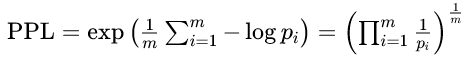

# CS336作业一实验总结
## 训练BPE分词器
- 总体链路：
    - 分块：将原语料切分为多个chunk，同时调整边界保证边界和文档分隔符重合，避免一个token被切开到两个chunk
    - 多进程并行预分词：分别读取chunk，按照特殊toekns切分，执行预分词
    - 合并所有 chunk 词频得到全局 word_dict
    - 初始化 pair_counts：词表初始化为每个字节一个token，然后根据word_dict统计pair_counts（类型为\{(token, token): count\}）
    - BPE 主循环迭代合并 pair 直到词表大小达标
    - 保存 vocab/merges
- 核心设计：
    - 特殊tokens处理：
        - 动机：特殊tokens不具有语义，不应该参与训练过程，考虑提前剔除，在预分词前直接按照特殊toekns切分
    - 多进程并行预分词：
        - 动机：预分词耗时长，但不同文档可以独立执行，因此考虑将原始文档划分为多个chunk，并行预分词，再合并结果即可
        - 优化：使用re.finditer来匹配，减少内存使用
    - 调整分块边界：
        - 动机：为了保证token完整性，需要找到一个确定的token末尾作为chunk划分边界，实际操作中，直接调整边界保证边界和文档分隔符重合
        - 设计取舍：如果强行寻找token末尾，因为读取文件是二进制，需要转换为str并局部执行预分词，计算offset，复杂度上升，故直接根据文档分隔符来移动最简单，代价是chunk不均匀，如果存在极大文档会导致切分数不足
    - 预分词：
        - 动机：防止 BPE 跨单词合并，保留词边界语义；先做初步统计，加速BPE主循环
        - 方案：GPT-2预分词，即基于正则的细粒度预分词，主要针对英文语料，识别英文缩写，保留单词前空格，以标记词边界（如I'm apple预分词为\["I", "'m", " apple"\]）
        - 输出：词频统计\{word: (tokens, count)\}，tokens的设计见主循环增量更新部分
    - 主循环增量更新：
        - 动机：主BPE训练循环需要构建pair_counts，记录token对的频次，如果每个循环都重新构建，开销巨大，因此选择增量更新
        - 思路：只有和当前token对重叠的token对频次受到影响，例如c a b d要合并a b，需要修改\[c a\]，\[a b\]，\[b d\]三对的频次，同时增加\[c ab\]，\[ab d\]两个token对，因此要维护word_dict中每个word的当前token序列，并在每次合并中修改该序列，便于确定需要修正频次的token对
        - 优化：易知合并后\[a b\]的频次一定为0，可以直接从pair_counts删除
- 实验分析：*Todo*

## 实现分词器类
- 函数：
    - 构造函数：可以接收vocab, merges, special_tokens构造，也可以从文件中自动读取
    - encode：接收文本，预分词，根据merges执行合并，编码为id
    - decode：接收id序列，查表解码回token序列，转换为str
- 核心设计：
    - 预分词：和训练BPE不同，预分词不需要统计词频，同时special_tokens不能直接舍弃，需要标注其无需合并，视为一整个token即可
    - 流式惰性编码：大文件分段编码，不一次性载入内存
    - 特殊tokens：用户可以自定义特殊tokens，直接添加到vocab中即可
- 性能：
    - 压缩比：通常使用文本的字节数 / 编码后的token数来表征分词器的压缩能力
    - 词表大小：**同一训练数据集、同样 BPE 训练流程**下：词表越大，能收录更长的高频子词，同样文本切分出的 token 数量更少
    - 训练语料：训练语料和编码文本越匹配，压缩效果越好
    - 编码速度：
        - 朴素实现：外层循环 = merges 总数量 M，每轮扫描 token 序列；很多 merges 在当前单词根本不存在，属于无效扫描。复杂度 \(O(M\cdot L)\)，L 为 token 序列长度。
        - 哈希优化方案：**不再外层迭代 merges 列表**，每次只扫描一遍当前 token 序列，找出所有现存相邻 pair，通过`merge_rank`字典查表获取优先级，选出最优 pair 合并。循环次数等于**该单词实际发生合并的次数**，远小于 M。

## 实现Transformer大语言模型
- 模型流程：
    - 输入：token序列，形状为(batch_size, sequence_length)
    - Token embedding：将每个token转换为语义向量，形状为(batch_size, sequence_length, embed_dim)
    - Transformer块：堆叠N层，不改变形状
    - LM Head：将语义向量直接投影到token的概率logits
        - 早期模型直接使用Token embedding的矩阵转置作为LM Head投影矩阵，理解为计算输出embedding和每个token对应的embedding的相似度（点积），作为logits；优点为节省参数，编解码语义空间一致；缺点为输入输出的最优概率分布不一致，效果不好
    - SoftMax+采样：将logits归一化，输出形状为(batch_size, sequence_length, vocab_size)，采样得到输出token
- 模块实现要点：
    - RMSNorm：平方前先提升数据类型，避免溢出
    - softmax：求解指数前，可以利用加减不变性，先减去最大值，防止溢出
    - RoPE：预计算所有位置的正余弦值，处理序列时直接取值，成对计算即可
    - 因果掩码：计算高效，一次矩阵乘法即可
    - 应用RoPE：注意只对QK使用，V不使用；注意每个head单独应用，维度不合并计算
    - TransformerLM：包含embedding，TransformerBlock，norm，LM Head四部分，SoftMax+采样是后续步骤
- 资源核算：
    - 参数量与内存占用：
        - embedding: vocab_size * d
        - num_layers * transforer_block: 
            - QKV and proj: 4 * d * d
            - RMSNorm: 2 * d
            - FFN: 3 * d * d_ff
        - ln_final: d
        - lm_head: d * vocab_size
    - FLOPS：只计算矩阵乘法
        - num_layers * transforer_block:
            - QKV and proj: 4 * 2 * l * d * d
            - attn: 2 * 2 * l * l * d
            - FFN: 3 * 2 * l * d * d_ff
        - lm_head: 2 * l * d * vocab_size
        - 当L较小时，FFN占用大部分计算量；当L>>d时，attn占用大部分计算量
        - 随着num_layers增加，lmhead所占比例下降；随着d增加，attn和lmhead和d成正比，FFN正比于d^2，因此FFN比例上升

## 训练LLM
- 组件：
    - 损失函数：CE
    - 优化器：AdamW
    - 主训练循环：加载数据，保存ckpt，管理训练
- 设计要点：
    - CE：softmax需要减去最大值，确保数值稳定性；分子的e指数和log可以抵消
    - PPL：困惑度，用于模型评估，公式为exp(ce)，含义上等于预测概率倒数的几何平均值，即模型做下一个 token 预测时，**平均相当于在多少个候选词里面随机猜**，推导如下：
    - Optimizer类：
        - \_\_init\_\_(self, params, ...)：构造时把超参数做成字典，调用父类构造函数即可
        - step(self)：遍历self.param_groups，每个成员是字典，遍历参数对象，取grad，self.state\[p\]取状态字典，必须用p.data原地修改
    - 梯度裁剪：防止梯度值过大，所有参数梯度看作一个整体向量，约束其l2范数，保证整体梯度方向不变
    - 内存映射：数据集过大时，只需要用内存映射获取batch即可
    - ckpt：
        - 包含内容：参数权重，优化器状态，迭代的iter数
        - 接口：
            - state_dict()：nn.Module和torch.optim.Optimizer都有，
            - load_state_dict(dict)：模块/优化器加载状态
            - torch.save(obj, dest)：保存字典到文件
            - torch.load(dest)：从文件加载字典

## LLM推理
- 流程：
    - 输入提示词
    - 经过TransformerLM后得到(seq_len, vocab_size)，取最后一行，做softmax
    - 采样直到<|endoftext|>
- 采样技巧：
    - 温度系数：v先除以温度系数，再做softmax，温度越大，所有 token 概率变得更平均，随机性大；温度越小，更尖锐，趋近于独热向量
    - Top-P：只取前概率之和恰好大于等于P的token

## 实验
- 要点：
    - 快速：在小规模模型与数据集上完成实验
    - 一致：消融模块与超参数
    - 记录：训练日志与曲线
- 小模型常用超参数：
    - Vocab size = 10000
    - Context length = 256
    - d_model = 512
    - d_ff = 1344
    - 层数、头数：4 layers，16 heads
    - 总处理 token 数：327,680,000 = $batch\_size \times total\_steps \times context\_length$
- 调试技巧：
    - 在单个 batch 上过拟合：拿固定一小批数据，反复训练，loss应该迅速降到0
    - 检查中间张量的 shape
    - 监控激活值，权重大小，梯度范数；如model.layers[0].attn.Wq.weight.norm()，x.norm()，p.grad.norm()
- 超参数影响：
    - lr：学习率过小导致训练收敛缓慢，loss偏高；曲线平滑但是下降后劲不足，欠拟合；学习率过大导致训练收敛不稳定，可能无法收敛
    - bs：更大的 batch 可以降低梯度噪声、提升 GPU 利用率，曲线更平滑、token 吞吐更快。但在固定总 token 预算下，更大 batch 会减少参数更新次数。在学习率随 batch 合理缩放时，中等 batch（如 64）通常取得最优验证效果。极小 batch 梯度震荡严重；而过大 batch 因为更新步数太少，泛化能力会受损。